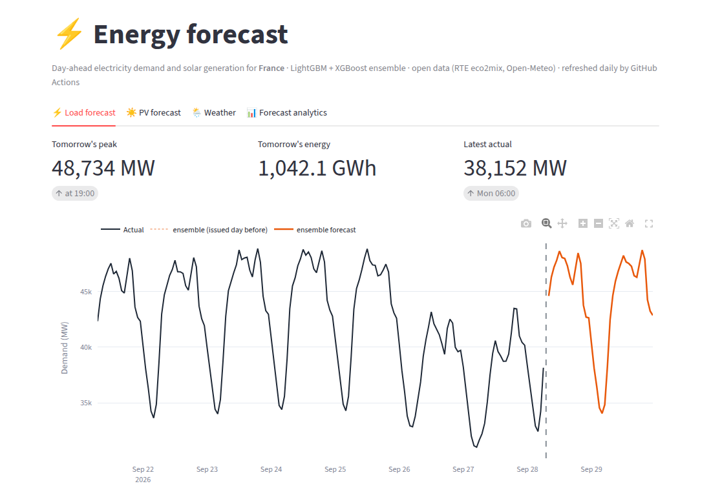
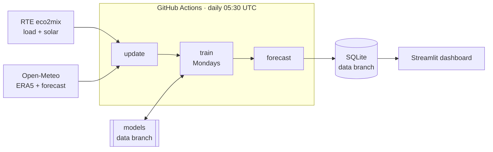

# ⚡ energy-forecast

Day-ahead forecasts of **electricity demand** and **solar (PV) generation** per grid zone.
It's built entirely on open data and free-tier services, and costs nothing to run.

A from-scratch take on the architecture Davide Deltetto described in his LinkedIn post
"Energy nerd pt. 2". That version covers Italy. This one starts with **France** (12 RTE regions)
because its data needs no API key. The market layer is pluggable, and an Italy/ENTSO-E adapter is included.



## What it does

| Feature | |
| --- | --- |
| ⚡ Load forecasting | hourly demand per region + national total, from the run time to the end of the next day |
| ☀️ PV forecasting | hourly solar generation per region |
| 🌦️ Weather analytics | temperature, feels-like, humidity, wind, solar radiation, cloud cover, observed and forecast |
| 📊 Forecast analytics | WAPE/MAE by model, by day, by hour of day and by zone, scored against what actually happened |

## Architecture



- **Pipeline** (`energy_forecast/`) runs daily on GitHub Actions:
  1. `update` pulls new actuals and weather into SQLite. The first run backfills two years.
  2. `train` retrains on Mondays, or when there's no model yet.
  3. `forecast` issues the next ~40 hours.
- **Models**: one global model per target, with the zone as a feature. It's an average of
  **LightGBM** and **XGBoost**. A seasonal-naive baseline (same hour last week) is stored
  alongside so the analytics show how much the ML adds. Features:
  - calendar: local hour, weekday, season, French holidays and *ponts*
  - weather at the target hour, plus rolling temperature
  - load/PV lagged by ≥ 48 h, so nothing leaks from inside the horizon
  - a PV capacity proxy: the best hour of the last 14 days
- **State**: the database and models live on a `data` branch that is **force-pushed as a
  single orphan commit**, so the repo doesn't grow. Forecast history is kept inside the
  database (`forecasts` table), so every forecast ever issued can be scored later.
- **Frontend** (`app/streamlit_app.py`) only reads the database. It never loads models, so it
  can be deployed publicly while this repo and its models stay private.

### Accuracy (28-day holdout at first training, Sept 2026)

WAPE = Σ|error| / Σ actual, over all regions and hours.

| | Ensemble | LightGBM | XGBoost | Naive (last week) |
| --- | --- | --- | --- | --- |
| Load | **2.83 %** | 2.86 % | 2.89 % | 4.25 % |
| PV | **14.8 %** | 14.5 % | 15.4 % | 23.1 % |

The holdout uses observed weather, so it is slightly optimistic. The dashboard's
*Live forecasts* view scores the real day-ahead forecasts once they have happened.

## Run it

```bash
python -m venv .venv && . .venv/bin/activate
pip install -r requirements.txt -r requirements-app.txt
python -m energy_forecast daily        # backfill (~1 min) + train (~3 min) + forecast
streamlit run app/streamlit_app.py
```

Steps can also run on their own: `update`, `train`, `forecast`.

Configuration is through environment variables:

| Variable | Default | |
| --- | --- | --- |
| `ENERGY_MARKET` | `france` | or `italy` (needs `ENTSOE_TOKEN`) |
| `ENERGY_DB` | `data/energy.db` | database path |
| `ENERGY_HISTORY_DAYS` | `730` | backfill depth |
| `ENERGY_DB_URL` | — | dashboard only: download the DB from here instead (e.g. the GitHub contents API for `data/energy.db?ref=data`, with `GITHUB_TOKEN`) |

## Adding a market

Subclass `markets.base.Market`: give it zones (code, name, lat/lon for the weather), a timezone,
a holidays country and `fetch_actuals(start, end)` returning hourly `ts, zone, load, pv`.
`markets/italy.py` is a template for ENTSO-E markets. It hasn't been run against the live API
yet: set `ENTSOE_TOKEN` and check the first `update` before trusting it.

## Data sources

- [RTE eco2mix regional data](https://odre.opendatasoft.com/explore/dataset/eco2mix-regional-tr/) on ODRÉ (Licence Ouverte)
- [Open-Meteo](https://open-meteo.com/) weather forecast and ERA5 archive (CC BY 4.0)
